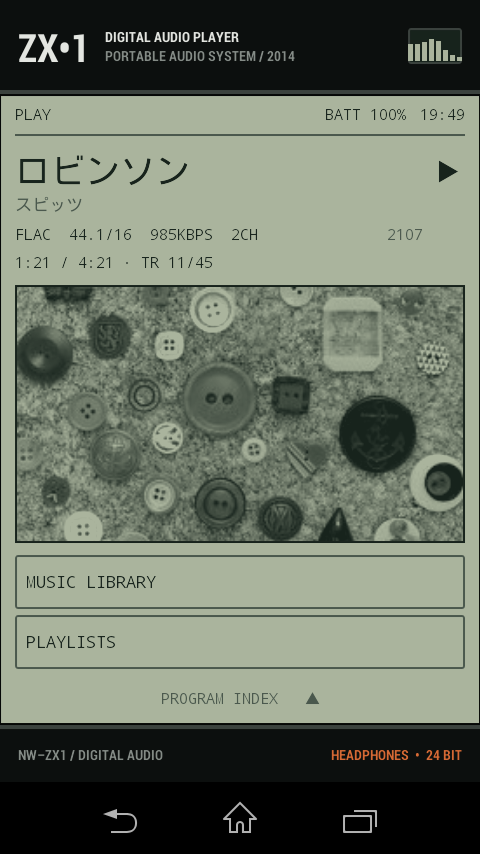
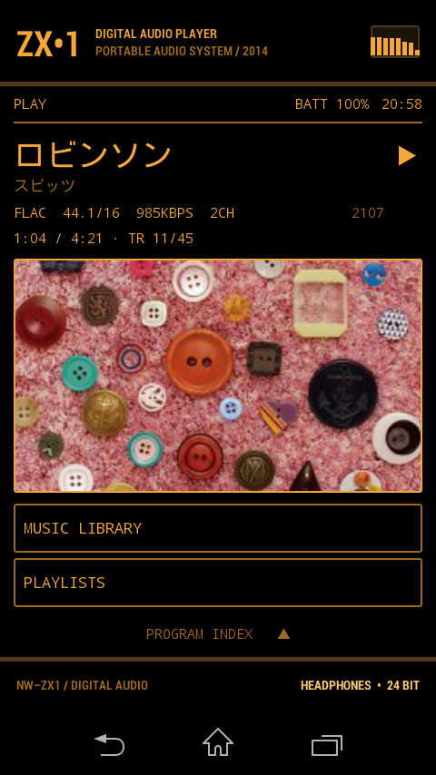

# ZX1 Retro Interface

An unofficial Android HOME replacement for the Sony NW-ZX1 digital audio player designed as if it might have been in the late 90s. The ZX1 is a lovely Sony Music Player sadly bundled with a near stock phone home screen. This launcher replaces it with something I like better. 

|  |  |
| :-----------------------------------------------------------------------------------------------------------------------------------------------------------------------------: | :----------------------------------------------------------------------------------------------------------------------------------: |
|                                                              The default **LCD** style shown with greyscale artwork                                                              |                                         The **Tube Amp** style shown with full-color artwork                                         |

## What is working

- **Displays the current track on the home screen.** Title and artist, codec / sample rate / bit depth / bitrate / channels with an HR mark on hi-res files, release year, elapsed and total time, queue position, and the player's PLAY / PAUSE / STOP state. The firmware doesn't announce any of this, so the launcher reads it about once a second from the Sony player's own service binder and media database.
- **Renders album art in the style of an old LCD.** The current track's cover in smooth greyscale by default, with a four-tone dither and full color as options in Settings. Tracks without readable art get a generated two-tone plasma animation.
- **Music Library browsing interface** Playlists, artists, albums, and songs as flat alphabetical lists with search. The launcher keeps its own cache of the firmware's media database, so the browser opens instantly and keeps working through Sony's rescans. Tap a track to play. The browser remembers where you were. Hold a track to append it to the current queue or add it to a playlist.
- **Playlist Manager** Create, rename, delete, add and remove tracks, and start playback from any row. Lists live in Android's media database. Sony's playlists are listed too, read-only.
- **Draws a spectrum display.** An eight-bar spectrum that displays in sync with the music. We can't access Android's own visualizer system as Sony's audio path bypasses this. Instead a background service analyzes each track on its first play and the bars replay that analysis against the playhead. This is the same approach Sony's own visualizer takes. The launcher brings its own ALAC and hi-res FLAC decoders for the formats that the stock Android media stack can't read. These are only generated once and then stored. You can also swap this out for a clock in Settings
- **Long title scrolling** This is a fun thing my old MiniDisc players used to do, so I brought it back here.
- **USB Storage** Plugging in the cable hands the music over to your computer, so the player can't play anything. The screens say so and give you a key to turn USB storage off. Afterwards you can watch the library being re-read before everything comes back.
- **Styles** Two visual styles (the "LCD-ish" default and an amber-on-black "Tube Amp" inspired style). Access it in the Settings screen using the gear icon in the Program Index. 
- **Primitive App Launcher** A super primitive app launcher just in case.
- No ads, no analytics, no network access.

Permissions Used: `RECEIVE_BOOT_COMPLETED` to refresh the library cache after power-on, `READ_EXTERNAL_STORAGE` for the music files, `WRITE_EXTERNAL_STORAGE` for the launcher's playlists in Android's media database, and `MOUNT_UNMOUNT_FILESYSTEMS` for the key that turns USB storage off.

## What it doesn't do

I think ZX1 works better as a music player than as a small phone/android handheld, so a lot of standard launcher features just aren't built:

- No widgets, wallpapers, folders, or home-screen customization. Home is the now-playing screen; everything else lives in the program index.
- No on-screen playback, volume, or hold controls. The ZX1's physical keys already do this, and they work with the screen off.
- No EQ or sound settings of its own — Sony's Sound Enhancement app does that.
- Nothing that isn't about playing music.

And some things aren't done yet:

- You can't access Notifications. 
- It will probably crash.
- Repeat and shuffle can't be seen or set from the launcher yet. A shuffle control is on the list.
- Sony's own playlists are read-only; the firmware's database doesn't accept writes from other apps.
- Queue editing stops at append and remove — no reordering.
- Appending to the queue is seamless in the common case; when the queue type has to change, the player rebuilds it with one audible hiccup.
- On a 192 kHz file's first listen, the spectrum can trail the playhead while analysis catches up. Every later play is in sync from the start.
- Tested only on the NW-ZX1 with firmware 1.13. On other devices the Sony-specific parts switch themselves off, which leaves a very spartan launcher.
- The app icon is still the upstream project's. A period-correct one is on the list.
- Does this work on other players? Maybe? I haven't tested. Let me know if you try it and it works.

## Install

**This is an early version so expect bugs. If you are ok with this, give it a try.**

Download the APK from the **Releases** page and sideload it over USB:

```sh
adb install -r zx1-retro-interface-<version>.apk
```

Press HOME on the ZX1 and choose **ZX1 Retro Interface**. 
**Don't select "always" for now because I promise you there are bugs!**

## Build

The project uses Gradle 6.9.4, Android Gradle Plugin 4.2.2, Android Platform 30, and Build Tools 30.0.3. The app has `minSdkVersion 16` and `targetSdkVersion 28` to stay compatible with the ZX1 firmware.

You need:

- A JDK between 8 and 15 — Gradle 6.9.4 doesn't run on newer JDKs
- An Android SDK with **platform 30** and **build-tools 30.0.3**
- The SDK path in `local.properties` (`sdk.dir=...`) or an `ANDROID_HOME` environment variable

```sh
./gradlew lintDebug assembleDebug
```

The APK ends up at `app/build/outputs/apk/debug/zx1-retro-interface-debug.apk`; install it the same way as above.

## How it works

Everything I learned about how things work on the ZX1 is written up in [docs/firmware-findings.md](docs/firmware-findings.md).
## License

Derived from [Light Android Launcher](https://github.com/light-launcher/Light-Android-Launcher) and distributed under the same license, the **GNU General Public License v2.0** — see [LICENSE](LICENSE). The interface and launcher behavior were substantially rewritten for the NW-ZX1; [NOTICE](NOTICE) summarizes the changes.

This is an independent project, not affiliated with or endorsed by Sony. Sony, Walkman, and NW-ZX1 are trademarks of their respective owner.
